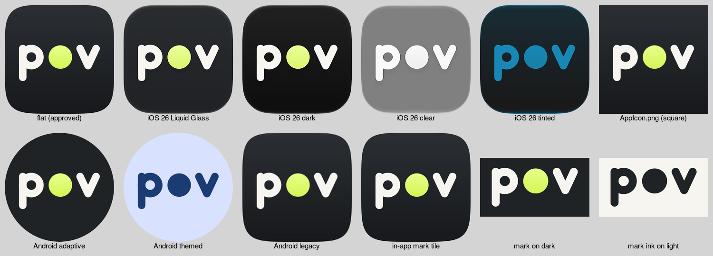

# RecordPOV logo assets: lowercase p●v

The approved app icon is the word "pov" in lowercase, drawn in off-white round strokes on a dark ink tile. The "o" is a lime record dot.

These are the approved source assets for the apps. The iOS Icon Composer bundle, launcher PNGs, and in-app marks are installed in `apps/ios` and `apps/android`. The app display name remains **RecordPOV**.

## Colours

| Name  | Hex       | Used for |
|-------|-----------|----------|
| Ink   | `#202326` | Icon background. In the SVG masters it is a top-to-bottom gradient from `#2B2F33` to `#17191C`. |
| Paper | `#F7F5F0` | The p and the v. |
| Lime  | `#DDFC67` | The dot. In the SVG masters it is a top-to-bottom gradient from `#E8FF8A` to `#D2F556`. |

On the 1024 px icon, the strokes are 70.4 px wide with round caps and joins.

## Update the iOS app (`apps/ios/Roast`)

1. **Replace the Icon Composer bundle.**
   - Delete `apps/ios/Roast/RecordPOV.icon` and copy `ios/RecordPOV.icon` in its place.
   - The new bundle has a single layer, `Assets/pov-mark.png`. The old `Assets/LOGO_LARGE.png` must not stay behind.
   - Translucency is switched off on purpose. With it on, Liquid Glass turns the lime dot olive.
   - `preview/ios26-*.png` shows how this bundle renders in the Default, Dark, Clear and Tinted modes. The previews were rendered with Apple's `ictool`.
2. **Replace the app icon PNG.**
   - Source: `ios/AppIcon.appiconset/AppIcon.png` (1024 px, opaque, no alpha).
   - Target: `apps/ios/Roast/Assets.xcassets/AppIcon.appiconset/AppIcon.png`.
   - `Contents.json` is unchanged.
3. **Replace the in-app mark.**
   - Source: `ios/RecordPOVMark.imageset/RecordPOVMark.png` (1024 px rounded tile on a transparent background).
   - Target: `apps/ios/Roast/Assets.xcassets/RecordPOVMark.imageset/RecordPOVMark.png`.
   - `Contents.json` is unchanged.
4. **Keep the old icon renderer removed.**
   - `apps/ios/render_icon.swift` was removed because it read the old `LOGO_LARGE.png` arrow and converted the artwork to a one-colour mask.
   - Install the approved exports from this package directly so the lime dot and exact geometry are preserved.

Optional: `ios/extra/AppIcon-dark.png` and `ios/extra/AppIcon-tinted.png` are dark and tinted variants for an iOS 18-style app icon set with appearances. They are not needed while the app uses `RecordPOV.icon`, which handles those modes on its own.

## Update the Android app (`apps/android/app/src/main/res`)

Copy `android/res/*` over `apps/android/app/src/main/res/`. The file names match the ones the app already uses, so no XML changes are needed.

| File | What it is |
|------|------------|
| `mipmap-{mdpi,hdpi,xhdpi,xxhdpi,xxxhdpi}/ic_recordpov.png` | Legacy launcher icon at 48, 72, 96, 144 and 192 px. |
| `drawable-nodpi/recordpov_launcher_foreground.png` | Adaptive icon foreground: 432 px (108 dp). The artwork fits inside the 66 dp safe zone. `mipmap-anydpi-v33` also uses this file as the monochrome (themed icon) layer. |
| `drawable-nodpi/recordpov_mark.png` | In-app rounded tile, 192 px. |

After copying, check that `@color/recordpov_icon_background` in `res/values/recordpov_colors.xml` is `#202326`.

Optional extras in `android/extra/`:

- `play-store-icon-512.png`: the Google Play listing icon. It is 512 px, square and opaque; Google Play rounds the corners itself.
- `vector/drawable/recordpov_launcher_{foreground,monochrome,background}.xml`: the same layers as vector drawables, which stay sharp at every density. To use them:
  1. Copy them into `res/drawable/`.
  2. Delete `drawable-nodpi/recordpov_launcher_foreground.png`. Two resources with the same name will not build.
  3. In `mipmap-anydpi-v26/ic_recordpov.xml` and `mipmap-anydpi-v33/ic_recordpov.xml`, set the background to `@drawable/recordpov_launcher_background`.
  4. In the v33 file, also set the monochrome layer to `@drawable/recordpov_launcher_monochrome`.
- `recordpov_launcher_monochrome.png`: a one-colour PNG of the themed icon layer.

## Other files

- `source/`: SVG masters.
  - `pov-icon.svg` is the approved icon at full bleed; iOS and Android apply the mask.
  - Also included: the rounded tile, the background and foreground layers, the letters-only and dot-only layers, and the bare p●v mark in three colourways (`on-dark`, `ink`, `white`).
- `png/`: ready-made PNGs. They include square and rounded icons at several sizes and the bare mark on a transparent background.
- `web/`: `favicon.ico` (16, 32 and 48 px), `favicon.svg`, `apple-touch-icon.png` (180 px), `icon-192.png` and `icon-512.png`.
- `preview/`: renders for checking. Do not ship these.

On light backgrounds, use the ink mark (`pov-mark-ink`) or the dark tile. The lime dot disappears on white.

## Before running Codex

Some files in this repo exist only in iCloud right now, so any attempt to read them hangs. Examples:
- `res/values/recordpov_colors.xml`
- `res/drawable-nodpi/recordpov_launcher_foreground.png`

In Finder, right-click the `VideoRoast` folder and choose **Download Now** first.
